# LiNeumann floating wall-face temperature dependency audit

Date: 2026-07-11

## Executive conclusion

`LiNeumannWallHeatFluxTemperature` does **not** make the OpenFOAM wall-face
temperature equal to the physical isothermal-wall temperature.  It deliberately
maintains two different quantities:

- `Tw` in the boundary dictionary is the physical temperature used by the Li
  closure.
- `TFace`, the evaluated value of the `T` patch, is the face state needed to
  make HiSA's discrete energy operator deliver the prescribed flux.

For the audited stationary, impermeable, no-slip HiSA setup with `AUSMDV`, local
pseudo-time stepping, and a stable unclamped nonlinear fixed point, the two
principal physical wall fluxes are protected:

- the energy inversion gives the requested normal wall heat flux;
- the `nut` inversion gives the requested primary tangential wall stress while
  its non-negative clamp is inactive.

That protection applies to the **boundary-face fluxes**, not to the complete
near-wall discretization.  The active `wVanLeer` reconstruction introduces a
separate, direct path into the converged bulk residual: wall `rho(TFace)` and
`H(TFace)` enter the first-cell gradient and limiter stencil, change the
reconstructed states on adjacent **internal** faces, and therefore change the
AUSMDV mass, momentum, and energy fluxes.  The dependency disappears on a
particular face only if the limiter happens to remain on an unchanged saturated
branch; the code provides no general cancellation.

The floating face state is nevertheless not inert.  It changes every generic
wall thermodynamic/transport value (`e`, `psi`, `rho`, `mu`, `alpha`, `nu`,
`rhoE`, sound speed, `alphaEff`, `muEff`), enters the active convective
reconstruction stencil, enters every compiled HiSA inviscid Jacobian through
its Lax-Friedrichs wall diagonal, changes nonlinear iteration history, seeds
the Li root solve, is written into restart state, and contaminates raw
wall-state output.  In addition to the active reconstruction route, it becomes
a direct physical-residual input through these guards or alternative branches:

- Li or solver face-temperature clamping;
- gradient under-relaxation or termination before the nonlinear fixed point;
- `nut = 0` clipping or a Li root failure;
- explicit `fluxScheme LaxFriedrichs`;
- moving, permeable, or nonzero-slip walls;
- global/transient time-step selection, mesh refinement based on `T`, radiation,
  CHT, buoyant pressure conditions, or another run-time consumer of patch `T`.

There is also an active SA route in the stock v2412 solve.  The custom
`nuTilda` patch class defines a `manipulateMatrix()` that would constrain the
first off-wall cells, but `SpalartAllmarasBase::correct()` never calls
`boundaryManipulate()`.  Consequently its `matrix.setValues()` is not executed:
the requested `nuTilda1` is a dead output, while wall `nu(TFace)` remains in the
SA diffusion operator and can affect the first cell and bulk turbulence field.
This describes the original audited runs.  The local WSL OpenFOAM source was
patched and rebuilt on 2026-07-11; the corrected branch and its A/B result are
documented below.

So a LiNeumann calculation is not discretely equivalent to a Dirichlet
isothermal wall even when both use the same `Tw`: one prescribes modeled flux
and has no wall-temperature energy diagonal; the other prescribes face
temperature and lets the heat flux emerge.

## Scope and completeness boundary

This audit follows the locally present sources through:

- the custom library at
  `/home/mgnadlinger/OpenFOAM/mgnadlinger-v2412/src/LiWallFunctions`;
- OpenCFD OpenFOAM v2412 at `/opt/of-v2412`;
- the locally sourced HiSA tree at
  `/home/mgnadlinger/OpenFOAM/mgnadlinger-v2412/modules/hysa`;
- all five physical flux schemes and all compiled inviscid/viscous Jacobian
  alternatives in the current HiSA build;
- the SA turbulence path and the function objects configured in the inspected
  `M6Tw025/LiNeumann_*` cases.

Those cases were used to resolve run-time branches, not to limit the general
code trace.  The M6Tw076 design/findings remain relevant to the same coupling.
Arbitrary dynamically loaded libraries, coded boundary conditions, function
objects, and `fvOptions` can look up `T` from the object registry, so no static
audit can enumerate consumers that are not present or configured locally.
Those open extension points are shown explicitly below.

Impact tags used in the dependency tree and tables:

- **R** — can enter the physical residual and change the nonlinear fixed point;
- **N** — changes the Jacobian, conditioning, iteration history, or a
  finite-iteration result, but not an exact unique residual root by itself;
- **C** — conditional path, inactive under the audited wall/run assumptions;
- **O** — terminal output unless reused externally;
- **X** — algebraically cancelled, constrained away, or otherwise a dead end.

## Complete dependency tree

```mermaid
flowchart TB
    TF["evaluated OpenFOAM wall value: TFace(n)"]

    subgraph PHYS["Li physical model"]
        MODE["T-BC runtime type + thermalMode"]
        TWD["dictionary Tw"]
        WP["physical wall Cp, rho, he, mu, kappa at (pWall,Tw)"]
        LIC["Li root and closure"]
        QT["qTargetOF"]
        TT["tauw target"]
        NT1["nuTilda1 target"]
        YPL["physical Li yPlus"]
        FAIL["C: root/status failure -> zero fallback targets"]
        TWD --> WP --> LIC
        LIC --> QT
        LIC --> TT
        LIC --> NT1
        LIC --> YPL
    end

    TF -.->|BC type, not numeric value| MODE
    MODE -->|intended isothermal| TWD
    TF -.->|C: adiabatic/fallback wall state only| WP

    subgraph UPDATE["Neumann update and evaluation cycle"]
        AEO["old/current alphaEff(TFace, alphat)"]
        HFN["heFaceNeeded = he1 + qTargetOF/(alphaEff delta)"]
        THE["thermo THE inversion; TFace is initial guess"]
        CLAMP["TFaceMin/TFaceMax clamp"]
        RELAX["gradientRelaxation + stored old gradient"]
        GT["stored gradT"]
        EVAL["fixedGradient evaluate: TFace = T1 + gradT/delta"]
        HEG["mirrored he gradient"]
        QT --> HFN
        AEO --> HFN --> THE --> CLAMP --> RELAX --> GT --> EVAL
        GT --> HEG
    end

    TF --> AEO
    TF -.->|initial guess; X for hConst exact inverse| THE
    EVAL --> TF

    subgraph STATE["OpenFOAM/HiSA wall-face state rebuild"]
        ET["eFace = he(pFace,TFace)"]
        PS["psi, rho"]
        TR["mu, alpha, kappa, nu"]
        CAL["Cp, Cv, gamma, CpByCpv; constants for actual hConst"]
        CS["sound speed c = sqrt(gamma/psi)"]
        CONS["rhoUFace, rhoEFace"]
        AE["alphaEff = CpByCpv (alpha + alphat)"]
        ME["muEff = mu + rho nut"]
        TF --> ET
        TF --> PS
        TF --> TR
        TF -.->|general thermo; X for actual hConst| CAL
        PS --> CS
        CAL --> CS
        ET --> CONS
        PS --> CONS
        TR --> AE
        CAL --> AE
        TR --> ME
        PS --> ME
    end

    AE --> AEO

    subgraph SOLVER["Physical residual branches"]
        ER["R: fvc::laplacian(alphaEff,eCalc)"]
        EOK["X for numeric TFace at fixed point: normal heat flux = qTargetOF"]
        MR["R: momentum viscous flux and stress"]
        NUTINV["nut inversion against patch mu and rho"]
        MOK["X for numeric TFace while unclipped: primary shear = tauw"]
        MCLIP["C/R: nut=0 clip -> shear over-delivery"]
        INVISC["compiled reconstructed fluxes: AUSMDV, AUSMPlusUp, AUSMPlusM, HLLC"]
        IOK["X only at stationary no-slip wall face: mass=0, energy=0, momentum=p Sf"]
        RECLIM["R: patch rho/H -> first-cell grad + wVanLeer limiter"]
        INTF["R: changed states and fluxes on adjacent internal faces"]
        NCORR["C/R: nonorth compact correction on adjacent internal faces; X on current orthogonal mesh"]
        LFF["C/R: explicit LaxFriedrichs dissipative wall flux"]
        SA["R in original unpatched run: SA wall diffusion uses nu(TFace)"]
        NOMAN["stock SA correct() omits boundaryManipulate"]
        NTDEAD["X in original unpatched run: computed nuTilda1 is never imposed"]
        NTSET["R in patched WSL run: setValues imposes nuTilda1 and cuts first-cell row"]
        SACONV["R downstream: changed internal mass flux -> SA convection in neighboring cells"]
        CELLS["cell residual/update: p1, U1, T1, rho, rhoE"]
        AE --> ER
        CONS --> ER
        ER --> EOK --> CELLS
        TT --> NUTINV
        TR --> NUTINV
        PS --> NUTINV
        NUTINV --> ME
        ME --> MR
        MR --> MOK --> CELLS
        NUTINV --> MCLIP --> CELLS
        PS --> INVISC
        ET --> INVISC
        CS --> INVISC
        INVISC --> IOK
        PS --> RECLIM
        ET --> RECLIM
        RECLIM --> INTF --> CELLS
        INTF --> SACONV --> CELLS
        ET -.-> NCORR
        NCORR -.-> CELLS
        PS -.-> LFF
        CONS -.-> LFF
        CS -.-> LFF
        LFF -.-> CELLS
        TR --> SA --> CELLS
        NOMAN --> NTDEAD
        NT1 --> NTDEAD
        NT1 -.-> NTSET -.-> CELLS
    end

    CELLS -->|next owner-cell state| LIC
    CELLS -->|next T1/p1| EVAL

    subgraph NUM["Implicit and iteration-only paths"]
        LFJ["N: LF wall diagonal in every compiled inviscid Jacobian"]
        VJE["X: viscous energy boundary Jacobian is zero for fixedGradient T"]
        VJM["N/R if clipped: viscous momentum boundary coefficient"]
        GMRES["GMRES/LUSGS increment and nonlinear trajectory"]
        LDT["X: local wall pseudo-dt uses owner-cell state"]
        GDT["C/N: global pseudo-dt or transient Courant deltaT"]
        SEED["patch nu + nut -> Li uTau root seed"]
        CS --> LFJ --> GMRES --> CELLS
        AE --> VJE
        ME --> VJM --> GMRES
        CS --> GDT --> GMRES
        TF --> LDT
        TR --> SEED
        NUTINV --> SEED
        SEED --> LIC
        SEED -.-> FAIL
        FAIL -.-> QT
        FAIL -.-> TT
        FAIL -.-> NT1
    end

    subgraph OUTPUT["Terminal, restart, and optional consumers"]
        RAW["O: raw T, e, psi, rho, mu, alpha, nu, rhoE, nut"]
        WHF["O: wallHeatFlux; protected only at same-state fixed point"]
        WSS["O: wallShearStress; protected unless clip/tensor caveat"]
        YPO["O: custom yPlus uses physical Tw"]
        LOG["O: Li diagnostics and AUSMDV minima"]
        MM["O: fieldMinMax, sampled patches/surfaces, ParaView"]
        RESTART["restart inputs: stored gradT, T/rho/nut/nuTilda fields"]
        REFINE["C/R: shockRefinement reads T and grad(T) -> mesh"]
        EXT["C/R: radiation, CHT, buoyant p BC, moving wall, custom consumers"]
        UNUSED["X: PatchData recovery and Pr after return"]
        TF --> RAW
        ET --> RAW
        PS --> RAW
        TR --> RAW
        CONS --> RAW
        NUTINV --> RAW
        HEG --> WHF
        AE --> WHF
        ME --> WSS
        YPL --> YPO
        TF --> LOG
        LIC --> LOG
        TF --> MM
        RAW --> MM
        GT --> RESTART
        RAW --> RESTART
        RESTART --> RELAX
        RESTART --> SEED
        TF -.-> REFINE
        REFINE -.-> CELLS
        TF -.-> EXT
        PS -.-> EXT
        TR -.-> EXT
        LIC --> UNUSED
    end
```



The two most important cycles visible in the graph are:

1. `TFace -> alphaEff -> new gradT -> next TFace`.  This is intended and
   cancels only at the same-state nonlinear fixed point.
2. `TFace -> sound speed -> implicit LF wall diagonal -> solver increment ->
   cell state -> next TFace`.  This is a numerical-path dependency in every
   compiled inviscid Jacobian.

The most important non-cyclic bulk leak is
`TFace -> rho/H patch values -> first-cell gradient/limiter -> reconstructed
states on adjacent internal faces -> AUSMDV residual`.  It remains in the
steady discrete equations even when the wall-face heat and shear cancellations
are exact.

## 1. What the custom boundary condition actually imposes

The T condition derives from `fixedGradient`, not `fixedValue`.  The custom
update computes and stores a gradient; OpenFOAM later evaluates

```text
TFace = TInternal + gradT/deltaCoeffs
```

in [`fixedGradientFvPatchField.C:182`](/opt/of-v2412/src/finiteVolume/fields/fvPatchFields/basic/fixedGradient/fixedGradientFvPatchField.C:182).
The base class returns the stored gradient from `snGrad()` and has
`gradientInternalCoeffs() = 0`, so the wall heat flux is explicit in an
implicit temperature linearization.

The Li update sequence is in
[`LiNeumannWallHeatFluxTemperatureFvPatchScalarField.C:417`](/home/mgnadlinger/OpenFOAM/mgnadlinger-v2412/src/LiWallFunctions/LiNeumannWallHeatFluxTemperature/LiNeumannWallHeatFluxTemperatureFvPatchScalarField.C:417):

1. `calcPatch()` produces `qw`/`qHalf` and the wall-stress/turbulence targets.
2. `qTargetOF` is selected and sign-converted.
3. The current patch `alphaEff`, owner-cell `he`, patch pressure, owner-cell
   `T`, and `deltaCoeffs` are read.
4. `heFaceNeeded = he1 + qTargetOF/(alphaEff*delta)` is formed.
5. `THE()` inverts that enthalpy to a desired face temperature, using the
   existing `TFace` as the nonlinear starting guess.
6. The desired temperature is clamped, converted to `gradT`, and relaxed
   against the old stored gradient.
7. An achieved `heGradient` is computed and mirrored into the `he` patch for
   reporting.
8. `fixedGradient::evaluate()` later creates the actual face value.

### `Tw` is separate from numeric patch `T`

`calcPatch()` reads the live patch temperature at
[`LiNeumannWallFunction.C:586`](/home/mgnadlinger/OpenFOAM/mgnadlinger-v2412/src/LiWallFunctions/LiNeumannWallFunction/LiNeumannWallFunction.C:586),
but in intended isothermal mode replaces the local wall temperature with the
dictionary scalar `Tw` at line 594.  Physical wall `Cp`, `rho`, `he`, `mu`,
and `kappa` are then evaluated at `(pWall,Tw)` (lines 612-657), and the Li
closure uses those values to obtain `uTau`, `tauw`, `qw`, `yPlus`, `mut1`, and
`nuTilda1` (lines 725-944).

Therefore numeric `TFace` does not enter a successfully converged isothermal
Li target through the physical wall state.  Its direct custom-library routes
are instead:

| Numeric `TFace` route | Downstream result | Classification |
|---|---|---|
| current `alphaEff(TFace)` | next enthalpy inversion and `gradT` | intended feedback; R while lagged/clamped, cancels at fixed point |
| `THE(..., TFace)` | nonlinear initial guess | X for current `hConst`; potentially N/failure for iterative variable thermo |
| `mu(TFace)`, `rho(TFace)` | stress-compensating `nut` | cancels while `nut > 0`; R when clipped |
| `nu(TFace)` and current `nut` | initial `uTau` root guess | N; C/R if it changes root status/fallback |
| numeric patch value in adiabatic mode | local wall state | C; dictionary `Tw` is not used there |
| T-BC run-time type / `fixesValue()` | automatic thermal intent | type dependency, not a dependency on the numeric value |

Two implementation details matter for reproductions:

- `Tw` is parsed as one scalar, not a per-face scalar field.
- `value uniform Tw` does not initialize or pin this patch.  With no stored
  `gradient`, the base constructor extrapolates the internal field and starts
  at zero gradient.  On restart it is the written `gradient`, not the written
  `value`, that carries the Neumann state.

## 2. Exact outer-iteration ordering and lag

The relevant HiSA order is:

```text
physical flux and residual with evaluated TFace(n)
  -> pseudo-time coefficients
  -> construct Jacobian with TFace(n)
       -> T.updateCoeffs() computes gradT(n+1), but does not evaluate it
  -> solve the conservative increment
  -> p/U/T.correctBoundaryConditions()
       -> fixedGradient evaluates gradT(n+1) against the new TInternal
  -> HiSA solver-level patch TMin/TMax clamp
  -> eFace = he(pFace,TFace(n+1))
  -> thermo.correct(): psi/mu/alpha at TFace(n+1)
  -> rebuild rhoFace, rhoUFace, rhoEFace
  -> turbulence.correct()
  -> next residual
```

The controlling sources are
[`hisaModule.C:532`](/home/mgnadlinger/OpenFOAM/mgnadlinger-v2412/modules/hysa/src/modules/hisa/hisaModule.C:532),
[`jacobian.C:54`](/home/mgnadlinger/OpenFOAM/mgnadlinger-v2412/modules/hysa/src/finiteVolume/jacobians/jacobian/jacobian.C:54),
and
[`updateFields.H:183`](/home/mgnadlinger/OpenFOAM/mgnadlinger-v2412/modules/hysa/src/modules/hisa/updateFields.H:183).

Consequences:

- Li diagnostics are formed with the pre-update `alphaEff`; the next residual
  uses transport recomputed from the newly evaluated face value.
- `qError` can be algebraically zero inside the BC while the residual still
  carries the iteration lag.
- `gradientRelaxation < 1` deliberately extends the memory over multiple
  iterations.
- HiSA's own `pseudoTime/TMin` or `TMax` can overwrite the evaluated face value
  after the Li update without changing the stored gradient.
- Only at a stable, same-state, unclamped nonlinear fixed point is the normal
  energy cancellation exact.

This ordering is the most plausible route by which floating `TFace` changes a
run stopped after a fixed number of iterations, even when its final target
formula is independent of `TFace`.

## 3. Thermodynamic and transport fan-out

For a non-value-fixing T patch, `hePsiThermo::calculate()` evaluates patch
`psi`, `mu`, and `alpha` from patch `(p,T)` in
[`hePsiThermo.C:97`](/opt/of-v2412/src/thermophysicalModels/basic/psiThermo/hePsiThermo.C:97).
HiSA first overwrites `eFace` with `he(pFace,TFace)`, so thermo's subsequent
`THE()` recovery is self-consistent with the floating face value; it cannot
restore dictionary `Tw`.

For the inspected
`hePsiThermo/pureMixture/sutherland/hConst/perfectGas/sensibleInternalEnergy`
selection:

| Face quantity | Dependence on `TFace` | Subsequent consumers |
|---|---|---|
| `e = he` | approximately `Cv*TFace` plus datum | `rhoE`, `eCalc`, physical flux schemes, output |
| `psi` | `1/(R*TFace)` | `rho`, sound speed, Jacobians, time-step branches, output |
| `rho` | `pFace/(R*TFace)` for active zero-gradient p wall | conservative fields, nut inversion, fluxes, output |
| `mu` | Sutherland law at `TFace` | `nu`, `muEff`, wall-stress split, momentum residual/Jacobian, output |
| `alpha` / `kappa` | Sutherland-derived | `alphaEff`, energy residual/inversion, output |
| `nu` | `mu/rho` | Li root seed and generic SA coefficient |
| `Cp`, `Cv`, `gamma` | constants in this actual `hConst` mixture | no numeric T route here; generally T-dependent with other thermo packages |
| `CpByCpv` | constant `gamma` here | multiplier in `alphaEff`; generally T-dependent |
| `alphaEff` | `gamma*(alpha(TFace)+alphatFace)` here | Li inversion, energy residual, wallHeatFlux, viscous Jacobian |
| `nut` | back-solved from `mu(TFace)` and `rho(TFace)` | `muEff`, SA/turbulence, stress, restart/output |
| `muEff` | `mu(TFace)+rho(TFace)*nut` | momentum diffusion/stress, viscous work and Jacobian |
| `c` | `sqrt(gamma/psi)` | every inviscid flux, every inviscid Jacobian, conditional time steps |
| `rhoUFace` | zero at the audited stationary no-slip wall | momentum/convective flux; conditional for moving/permeable wall |
| `rhoEFace` | built from `rho*(e-eZero+U^2/2)` | inviscid/energy residual and restart; thermal factors nearly cancel for the actual hConst perfect gas at fixed p |

The active wall pressure is `zeroGradient`, so `pFace = p1` is upstream of the
thermo calculations.  The contaminated `rhoFace` does not feed backward into
that boundary condition directly.  The optional `characteristicWallPressure`
branch would instead substitute owner-cell density during HiSA's boundary
rebuild; it is not the branch used in the inspected cases.

## 4. Physical residual branches

### 4.1 Energy diffusion

HiSA forms

```cpp
eCalc = rhoE/rho - 0.5*magSqr(U);
rhoER += fvc::laplacian(alphaEff, eCalc, ...);
```

in
[`residualsUpdate.H:58`](/home/mgnadlinger/OpenFOAM/mgnadlinger-v2412/modules/hysa/src/modules/hisa/residualsUpdate.H:58).
At the stationary wall after the state rebuild, `eCalcFace` reduces to the
face internal energy minus the uniform `eZero`.  For the current pure mixture,
the reference contribution has no wall-normal difference.  The BC and the
residual therefore use the same face-cell energy secant and boundary
`deltaCoeffs`.

The normal wall contribution is exactly `qTargetOF` at an unclamped same-state
fixed point.  It is not exact while any of these is active:

- the Li `TFaceMin/TFaceMax` clamp;
- `gradientRelaxation` during continued change;
- HiSA's later `TMin/TMax` clamp;
- the one/update iteration property lag;
- the `VSMALL` coefficient guard;
- a failed/non-round-tripping thermo inversion;
- spatially varying composition/reference energy, which was not present in
  the audited pure-mixture cases.

#### No compact correction at the wall face; conditional internal-face route

A deeper trace corrects the preliminary suspicion of a compactSnGrad
non-orthogonal leak.  At every uncoupled physical patch OpenFOAM projects the
patch delta vector onto the face normal
([`fvPatch.C:156`](/opt/of-v2412/src/finiteVolume/fvMesh/fvPatches/fvPatch/fvPatch.C:156)).
The HiSA compact correction vector is then identically zero at that boundary
([`compactSnGrad.C:46`](/home/mgnadlinger/OpenFOAM/mgnadlinger-v2412/modules/hysa/src/finiteVolume/compactSnGradScheme/compactSnGrad.C:46)).
Core `snGrad` also dispatches an uncoupled boundary directly to the patch
field's `snGrad()`
([`snGradScheme.C:137`](/opt/of-v2412/src/finiteVolume/finiteVolume/snGradSchemes/snGradScheme/snGradScheme.C:137)).

Thus the Li use of `patch().deltaCoeffs()` exactly matches the active
`Gauss linear compact` wall coefficient, even if the owner-to-face geometry is
skew.  There is no omitted compact correction at this uncoupled wall.

This statement is local to the boundary face.  On a non-orthogonal **internal**
face incident to a wall-owner cell, `compactSnGrad` interpolates
`grad(eCalc)` into its explicit correction.  The owner-cell Gauss gradient
contains the wall `eCalcFace(TFace)`, so this creates the conditional path

```text
TFace -> wall eCalc -> first-cell grad(eCalc)
      -> nonorthogonal correction on adjacent internal face
      -> energy residual.
```

The inspected representative mesh has maximum and average non-orthogonality
equal to zero, so this correction vector is zero on all of its faces.  The
route is therefore inactive there, but it must be retained in the general
dependency tree for non-orthogonal meshes.  It is distinct from the active
`wVanLeer` limiter route described next, which remains even on an orthogonal
mesh.

### 4.2 Momentum diffusion and wall stress

The custom evaluator reads patch `mu` and `rho` and installs

```text
nut = max(0, (tauw - muFace*|snGrad(U)|)
             /(rhoFace*|snGrad(U)|))
```

at
[`LiNeumannWallFunction.C:946`](/home/mgnadlinger/OpenFOAM/mgnadlinger-v2412/src/LiWallFunctions/LiNeumannWallFunction/LiNeumannWallFunction.C:946).
Hence

```text
(muFace + rhoFace*nut)*|snGrad(U)| = tauw
```

algebraically while `nut > 0`.  This protects the primary tangential shear in
the momentum residual and standard wall-shear output at a same-state fixed
point.

It fails or is qualified when:

- `muFace*|snGrad(U)| > tauw`, forcing `nut=0`; the delivered stress then
  exceeds the target by the recorded `tauDeficit`;
- the root solve fails or a status fallback zeros the targets;
- the residual and boundary update are at different iteration states;
- full `dev2(gradU)` tensor/curvature components differ from the scalar
  tangential calibration;
- the wall moves or transpires, making viscous work nonzero.

For a stationary wall `Up=0`, the `sigmaDotU` wall energy-work term is an
algebraic dead end.

### 4.3 Inviscid fluxes: wall-face cancellation but active bulk reconstruction

The current HiSA library compiles exactly five selectable physical schemes.
At an uncoupled patch the reconstructed left and right states both equal the
patch value.  With a static stationary impermeable no-slip wall, all
T-dependent state values are identical on the two sides and normal velocity
is zero.

That proves only the flux through the **wall boundary face**.  In the active
`AUSMDV + wVanLeer` configuration, the same T-derived patch values also enter
the stencil that reconstructs states on adjacent internal faces:

1. AUSMDV reconstructs `rho` and total enthalpy `H`; their wall values are
   `rhoFace=pFace/(R*TFace)` and approximately `HFace=Cp*TFace` for the actual
   thermo package
   ([`ausmDVFluxScheme.C:109`](/home/mgnadlinger/OpenFOAM/mgnadlinger-v2412/modules/hysa/src/finiteVolume/fluxSchemes/ausmDV/ausmDVFluxScheme.C:109)).
2. `LimitedReconstructionScheme` calls `fvc::grad()` and uses the wall-owner
   gradient in the limiter for every incident internal face
   ([`LimitedReconstructionScheme.C:105`](/home/mgnadlinger/OpenFOAM/mgnadlinger-v2412/modules/hysa/src/finiteVolume/reconstructionSchemes/LimitedReconstructionScheme/LimitedReconstructionScheme.C:105)).
3. The active `cellLimited Gauss linear 1` gradient includes uncoupled patch
   values both in the Gauss boundary sum
   ([`gaussGrad.C:89`](/opt/of-v2412/src/finiteVolume/finiteVolume/gradSchemes/gaussGrad/gaussGrad.C:89))
   and in its boundary extrema/limiting
   ([`cellLimitedGrad.C:125`](/opt/of-v2412/src/finiteVolume/finiteVolume/gradSchemes/limitedGradSchemes/cellLimitedGrad/cellLimitedGrad.C:125)).
4. The resulting wVanLeer limiter changes the interpolation weights and hence
   `rho_L/rho_R` and `H_L/H_R` on adjacent internal faces
   ([`reconstructionScheme.C:101`](/home/mgnadlinger/OpenFOAM/mgnadlinger-v2412/modules/hysa/src/finiteVolume/reconstructionSchemes/reconstructionScheme/reconstructionScheme.C:101)).
5. Those reconstructed states enter AUSMDV's mass, momentum, and energy fluxes,
   whose divergence updates the wall-owner and neighbouring cells.

There is no wall-flux cancellation for this internal-face route.  It is a real
dependence of the steady discrete residual on numeric `TFace`, initially local
to the first-cell stencil and then propagated through the coupled flow and SA
equations.  It vanishes face-by-face only if the limiter output is unchanged --
for example, an exactly saturated first-order branch -- which is not guaranteed
by the selected scheme.

| Compiled scheme | Reads T-derived state | Wall result under audited assumptions | Complete classification |
|---|---|---|---|
| `AUSMPlusUp` | `rho`, `H`, `c`, usually `gamma` | mass 0, energy 0, momentum `pFace*Sf` | X at wall; R/C through high-order internal reconstruction |
| `AUSMPlusM` | `rho`, `H`, `c`, usually `gamma` | same | X at wall; R/C through high-order internal reconstruction |
| `AUSMDV` (active) | `rho`, `H`, `c`, usually `gamma` | same; H/c minima can change console log | X at wall; **R through active wVanLeer internal limiter**; O log |
| `HLLC` | `rho`, `E`, `H`, `c` | same | X at wall; R/C through limited internal interpolation |
| `LaxFriedrichs` | `rho`, `rhoU`, `rhoE`, `c` | central part is ideal, dissipative wall-gradient part remains | C/R |

The direct Lax-Friedrichs residual path is

```text
TFace -> rho/rhoE/c -> lambdaConv * snGrad(rho,rhoU,rhoE)
      -> continuity, momentum, and energy residuals.
```

Its implementation is
[`laxFriedrichsFluxScheme.C:84`](/home/mgnadlinger/OpenFOAM/mgnadlinger-v2412/modules/hysa/src/finiteVolume/fluxSchemes/laxFriedrichs/laxFriedrichsFluxScheme.C:84).
The explicit Lax-Friedrichs boundary leak is not active in the inspected
`AUSMDV` cases.  The separate wVanLeer internal-face leak **is** active in the
selected discretization.

The reconstructed-scheme cancellations also cease for moving meshes,
permeable/transpiring walls, nonzero relative normal velocity, unequal coupled
states, or an invalid thermo state.

### 4.4 SA turbulence

Generic SA uses patch `nu(TFace)` in `DnuTildaEff`.  The custom
`nuTildaLiNeumannWallFunction` fixes the physical-wall patch value to zero and
*defines* a `manipulateMatrix()` that calls
`matrix.setValues(faceCells, data.nuTilda1)`
([`nuTildaLiNeumannWallFunctionFvPatchScalarField.C:97`](/home/mgnadlinger/OpenFOAM/mgnadlinger-v2412/src/LiWallFunctions/nuTildaLiNeumannWallFunction/nuTildaLiNeumannWallFunctionFvPatchScalarField.C:97)).
Defining this callback does not make OpenFOAM invoke it.

The stock v2412 `SpalartAllmarasBase::correct()` sequence used by the original
audited runs was

```text
assemble nuTildaEqn -> relax -> fvOptions.constrain -> solve
```

and contained no
`nuTildaEqn.ref().boundaryManipulate(nuTilda_.boundaryFieldRef())` call
([`SpalartAllmarasBase.C:466`](/opt/of-v2412/src/TurbulenceModels/turbulenceModels/Base/SpalartAllmaras/SpalartAllmarasBase.C:466)).
The normal segregated scalar solve also does not call the one-argument patch
callback; its matrix manipulation at
[`fvScalarMatrix.C:189`](/opt/of-v2412/src/finiteVolume/fvMatrices/fvScalarMatrix/fvScalarMatrix.C:189)
belongs to the separate implicit-patch assembly route.  Thus, in the original
audited runs, the custom `setValues()` was never reached.

The route

```text
TFace -> nuFace -> SA wall diffusion -> first cell
```

is therefore **active**, while the intended branch

```text
Li closure -> nuTilda1 -> matrix.setValues(first cells)
```

was a dead end.  Direct run evidence confirms it: near `x=0.8` the
diagnostic target is `nuTilda1=0.0187034`, whereas the solved first-cell field
is `0.0225512`, 20.6% above the value that was supposed to be imposed.

If the SA equation explicitly calls `boundaryManipulate()` after relaxation
and `fvOptions.constrain()` but before `solve()`, `fvMatrix::setValues()` then
removes the constrained row's internal and boundary connections before
imposing `nuTilda1`
([`fvMatrix.C:246`](/opt/of-v2412/src/finiteVolume/fvMatrices/fvMatrix/fvMatrix.C:246)).
The local WSL source now contains that call and the compressible turbulence
library has been rebuilt.  In the controlled patched run, all 150 first-cell
values match `nuTilda1` with mean relative mismatch `1.55e-7` and maximum
`5.21e-6`.  In that corrected solver the molecular wall-diffusion path becomes
a dead end at the first cell.

There is also an active downstream route from the reconstruction leak.  The
changed AUSMDV internal-face mass flux is the `phi` supplied to the SA model,
and SA uses it in `fvm::div(phi,nuTilda)`.  In the current uncorrected solver it
can affect both the first and subsequent cell rows.  After the intended
`setValues()` constraint is activated, the coefficient on the first internal
face still enters the neighbouring row/source when the constrained value is
eliminated.  Consequently

```text
TFace -> rho/H reconstruction limiter -> changed internal phi
      -> SA convection in the next cell -> nut/muEff/alphaEff -> bulk flow
```

is real with or without the first-cell constraint.  It is distinct from the
molecular wall-diffusion path, which is active only while the intended matrix
callback remains uncalled.

## 5. Jacobians, pseudo-time, and finite convergence

### Inviscid Jacobians

All three compiled inviscid Jacobians -- `LaxFriedrichs`,
`discreteLaxFriedrichs`, and `centralLaxFriedrichs` -- form
`cFace=sqrt(gammaFace/psiFace)` and add a Lax-Friedrichs stabilization
Laplacian **including physical boundaries**.  Sources include
[`laxFriedrichs.C:128`](/home/mgnadlinger/OpenFOAM/mgnadlinger-v2412/modules/hysa/src/finiteVolume/jacobians/jacobianInviscid/laxFriedrichs/laxFriedrichs.C:128)
and
[`fvjOperatorsTemplates.C:696`](/home/mgnadlinger/OpenFOAM/mgnadlinger-v2412/modules/hysa/src/finiteVolume/fvjMatrix/fvjOperatorsTemplates.C:696).

This is an unconditional route in the current solver family:

```text
TFace -> psiFace/gammaFace -> cFace -> wall-cell matrix diagonal
      -> GMRES/LUSGS increment -> nonlinear trajectory.
```

It changes conditioning, convergence rate/robustness, and the result at a
finite iteration or stopping tolerance.  By itself it does not change a unique
exact root of an unchanged physical residual.

The separate inviscid physical-boundary linearization has no surviving direct
T sensitivity for the audited wall: its T derivatives are multiplied by
relative normal velocity, and the no-slip U boundary eliminates the relevant
internal coefficients.  The surviving pressure-force derivative is not a
numeric `TFace` dependency.

### Viscous Jacobians

The compiled `laplacian` alternative reads patch `alphaEff` and `muEff`.
The energy boundary term is multiplied by the T patch's
`gradientInternalCoeffs()`, which is zero for `fixedGradient`; the prescribed
heat flux consequently has no wall energy diagonal.  The momentum boundary
coefficient contains `muEff` and is protected only while the `nut` shear
inversion is in its unclipped, same-state regime.  The compiled
`spectralRadius` alternative returns zero physical-boundary Jacobians and
excludes them from its default stabilization Laplacian.

### Pseudo/physical time

| Branch | Numeric `TFace` route | Result |
|---|---|---|
| active local pseudo-time at a physical wall | uses owner-cell `gamma`, `psi`, `U` | X |
| global pseudo-time | interpolates face wave speed | C/N |
| transient Courant calculation / adjusted physical `deltaT` | interpolates `sqrt(gamma/psi)` | C/R through time-step history |
| switched pseudo-Courant adaptation | responds to residual/matrix changes | indirect N |
| density/energy bounds and pseudo-Co damping | can be activated by a different solver trajectory | indirect N, potentially path-changing |

The local/global branches are in
[`hisaModuleTimestepping.C:66`](/home/mgnadlinger/OpenFOAM/mgnadlinger-v2412/modules/hysa/src/modules/hisa/hisaModuleTimestepping.C:66).

## 6. Outputs, dead ends, and restart feedback

| Consumer | What it receives | Follow-up status |
|---|---|---|
| raw wall `T` | tangent/extrapolated `TFace`, never dictionary `Tw` | O; restart `gradient` is the authoritative T-BC state |
| raw wall `e`, `psi`, `rho`, `mu`, `alpha`, `nu`, `rhoE` | state evaluated from `TFace` | O unless sampled/reused; `rho` is READ_IF_PRESENT on restart |
| raw wall `nut` | compensating bookkeeping value | O and MUST_READ/AUTO_WRITE restart seed |
| raw wall `alphat` | prescribed conditioning constant | O/restart, but not caused by `TFace` when fixedValue |
| raw wall `nuTilda` | exactly zero | X at patch; current first-cell field is an unconstrained SA solution/restart state, while computed `nuTilda1` is X until matrix manipulation is activated |
| `fieldMinMax(T)` | includes boundary values | O; a floating face can become global reported min/max |
| sampled patch/surface and ParaView | literal registered patch values | O; wall T/rho/mu/nut are not physical wall-state data |
| `wallHeatFlux` | `alphaEff*he.snGrad()` using mirrored gradient | protected at same-state unclamped fixed point; otherwise reports achieved/lagged value |
| `wallShearStress` | total `devRhoReff` | protected primary shear while unclipped; reports over-delivery when clipped |
| default `yPlus` FO | virtual custom `nut` wall-function `yPlus()` | physical Li value from `Tw`; seed/status caveat only |
| generic yPlus with wall-function delegation disabled | patch `nuEff/nu` | C/O, directly contaminated |
| wall Mach number | `|U|/sqrt(gamma*p/rho)` | X (=0) at stationary no-slip wall; C otherwise |
| Li `.dat` diagnostics/log | target, achieved gradient, TFace, stress data | O; `qError` does not expose later thermo lag |
| AUSMDV H/c global minima | T-derived reconstructed states | O console text only |
| `PatchData.recovery`, `PatchData.Pr` after return | stored values with no caller | X, true code dead ends |
| written T `gradient` | old gradient used by next relaxed update | restart feedback, not terminal |
| written `nut` | initial root seed on restart | restart feedback, not terminal |

The custom T constructor reads `gradient` if present.  If absent, the
`fixedGradient` base extrapolates owner-cell T and starts with zero gradient;
the dictionary `value` entry is ignored for initialization.  A written
`gradient` can therefore carry a prior floating-face history into a restart.

## 7. Conditional consumers outside the active aero case

These branches are inactive in the inspected cases but are genuine routes to
solution changes:

| Conditional feature | Dependency chain |
|---|---|
| HiSA `shockRefinement` | `TFace`/`grad(T)` -> refinement marking -> mesh -> every residual |
| radiation | `TFace^4` or temperature-dependent emissivity -> radiative flux/source |
| conjugate heat transfer | patch T is exchanged as physical interface temperature -> solid/fluid coupling |
| pressure-based buoyant solvers | `rho(TFace)` in `p_rgh`/`fixedFluxPressure` terms -> pressure boundary |
| moving/transpiring wall | T-derived density/enthalpy/sound speed enter nonzero convective flux; `tau.Uwall` enters energy |
| explicit HiSA `fluxScheme LaxFriedrichs` | T-derived state and wave speed enter dissipative physical flux |
| global/transient timestep | face sound speed changes pseudo/physical time step |
| generic heat-transfer/Nusselt/Stanton processing | literal patch T is interpreted as wall temperature |
| arbitrary coded BC/function object/fvOption | object-registry lookup of T or a T-derived field; unbounded extension point |

No active radiation, CHT, `fvOptions`, or shock-refinement path was found in
the inspected aero cases.

## 8. Why this cannot exactly replicate a Dirichlet isothermal wall

| Property | Dirichlet isothermal T BC | LiNeumann isothermal mode |
|---|---|---|
| OpenFOAM patch value | exactly `Tw` | floating tangent `TFace` |
| Physical input | wall temperature | `Tw` parameter inside wall model |
| Wall heat flux | emerges from resolved face-cell state and transport | prescribed from Li closure |
| Energy boundary Jacobian | temperature constraint supplies diagonal feedback | fixedGradient gives zero gradient-internal coefficient |
| Wall thermo/transport fields | evaluated at physical `Tw` | evaluated at numerical `TFace` |
| First-cell solution | constrained indirectly by fixed wall T | driven by modeled heat flux |
| Converged equivalence condition | n/a | only if Li target equals the Dirichlet solution's flux and all other model/discretization differences vanish |

Therefore a disagreement is not, by itself, proof that the floating face state
has leaked into the physical residual.  The two problems impose different
boundary data.  However, the source trace now identifies one active mechanism
that can make two equally converged LiNeumann solutions differ even when their
wall targets agree: the T-dependent `rho/H` boundary stencil in high-order
reconstruction.  To isolate it, compare two LiNeumann runs that preserve the
same target flux but deliberately change conditioning `alphat`, converge both
far below the observed difference, and inspect the wall-adjacent wVanLeer
limiters/internal-face fluxes.

## 9. Actual-case checks and documentation corrections

### Conditioning discrepancy

The original design and example describe plain wall `alphat fixedValue 0`.
The inspected M6Tw025 LiNeumann cases actually use `alphat fixedValue 0.1`
([`0.org/alphat:39`](/home/mgnadlinger/Xue_et_al/flat_plate/M6Tw025/LiNeumann_2e-1/0.org/alphat:39)).
For the actual perfect-gas/internal-energy setup this makes
`alphaEff approximately gamma*(0.1+alphaLam) approximately 0.14 kg/(m s)`,
so `alphat` dominates the face-energy coefficient and shrinks the required
temperature excursion.  It is a conditioning choice, not a physical wall
turbulent heat-flux prediction, and should be documented consistently.

As a quantitative sanity check, 200 final diagnostic faces in the inspected
`M6Tw025/LiNeumann_2e-1` run had physical `Tw=97.5 K` but
`TFace=55.98...184.01 K`.  The target heat-flux relative error remained below
about `4.3e-4`, while the corresponding raw wall `rho`, `mu`, and `nu` varied
materially from their values at `Tw`.  This is direct evidence that correct
normal-flux delivery and incorrect interpretation of raw wall state can coexist.
The reported minimum can lie below the configured `TFaceMin=97.5 K` because
the implementation clamps the *desired* face temperature before blending the
new gradient with the old one; it is not a hard post-evaluation bound when
`gradientRelaxation<1`.

An additional inspected local case,
`M6Tw025/LiNeumann_3p5e-1`, is materially different at its final written
iteration.  Aggregating all 16 processor diagnostics at time `4000` gives:

| check | observed value |
|---|---:|
| wall faces | 200 |
| physical dictionary `Tw` | 97.5 K |
| diagnostic `TFace` range | 93.942...183.958 K |
| `alphaEff` range | 0.1400128...0.1400249 kg/(m s) |
| faces with relative `qError > 1%` | 16 |
| faces with relative `qError > 10%` | 14 |
| extent of the `>10%` region | `x=0.00005...0.005385 m` |
| faces with delivered/target heat-flux sign disagreement | 9 |
| largest `abs(qError/qTargetOF)` | 14.317 at `x=0.001865 m` |
| nonzero Li status | 0 |

Thus the representative run is **not** in the protected same-state energy
fixed point near its leading edge, even though the Li closure itself reports a
healthy status on every face.  The standard `wallHeatFlux` output independently
shows the same symptom at time 4000 (`min=-1.896e5`, `max=3.128e6 W/m2`), while
the target diagnostic is much smaller on the affected faces.  This is the
expected active path

```text
old gradient + gradientRelaxation 0.3 + changing T1/qTarget/alphaEff
  -> achieved TFace
  -> next residual wall heat flux
  -> changed cell state and next target
```

This proves that the lagged wall-energy path is active in that region.  It does
not exclude the separate AUSMDV wVanLeer internal-face path identified above;
the existing diagnostics do not record limiter weights or internal-face flux
sensitivity.  A comparison against a fixed-temperature wall after exactly
4000 pseudo-iterations therefore mixes at least four effects: different
mathematical boundary data, Li wall-model error, a still-active Neumann update
cycle, and possible reconstruction-stencil leakage.  The small downstream
`qError` does not validate the upstream portion or test the limiter path.

### Li-et-al case: `alphat` sweep and wall-resolved SA comparison

The same-mesh `alphat=0.05, 0.5, 5, 10` sweep changes the numerical face state
but barely changes the converged modeled targets.  At time 5000, lowering
`alphat` from 10 to 0.05 changes mean `TFace` from 6508 K to 6334 K and its
minimum from 2510 K to 2183 K, while the area-averaged heat flux changes by
only about 0.006% and wall shear by about 0.003%.  At `x=0.8`, developed-field
differences between those two endpoints are only 0.13 K in `T`, 17 Pa in `p`,
and 0.02 m/s in streamwise velocity.  The structural reconstruction route is
still present, but this sweep gives no evidence that it controls the developed
solution in this case.

Against the final wall-resolved `SA_1e-3` result, the `alphat=0.05` case has
area-average excesses of 13.72% in heat-flux magnitude and 8.65% in shear.  At
`x approximately 0.8`, the Li closure requests 29.666 MW/m2 and 7237 Pa versus
resolved values of 26.206 MW/m2 and 6598 Pa.  The Neumann and shear inversions
deliver those Li requests to roundoff, so the immediate discrepancy is in
target generation, not boundary-flux delivery.

An a-priori evaluation sharpens that localization.  Supplying the implemented
Eqs. (40)--(42) and (33) with the wall-resolved SA `U` and `T` sampled at the
coarse first- and second-cell locations (`y=0.000195` and `0.0005914 m`) gives
30.951 MW/m2 and 7112 Pa: 18.1% and 7.8% above the resolved wall values even
before any floating-face or coarse-solution feedback.  The same calculation
reproduces the Li diagnostic when supplied with the Li sampled state.  Thus a
substantial part of the comparison error is already present in the frozen-gas
closure at these inputs; it cannot be repaired by changing `alphat` or the
`TFace` limit alone.

The fixed default `omegaH=0.72` is also not the Sutherland-law exponent of this
calorically perfect gas; the effective exponent over the sampled temperature
range is about 0.525.  Re-evaluating the same states with 0.525 lowers the
predicted heat flux and shear by only about 2%, however, so this coefficient
mismatch is a secondary contributor rather than the full explanation.

Separately, the original run omitted the intended SA first-cell prescription,
as detailed in Sec. 4.4.  A controlled 5000-step local A/B was completed after
adding the missing matrix callback.  The patched run enforces Eq. (39), but its
full-wall heat-flux and shear errors versus resolved SA increase from 13.72%
and 8.65% to 15.10% and 9.80%.  Downstream of `x=0.1 m` both improve by about
one percentage point, while a narrow leading/transitional region near
`x=0.05 m` changes from underprediction to strong overprediction and dominates
the full-wall change.  See
[`RESULTS_SA_boundaryManipulate_AB.md`](/home/mgnadlinger/OpenFOAM/mgnadlinger-v2412/src/LiWallFunctions/RESULTS_SA_boundaryManipulate_AB.md).

### Corrections to the existing design/findings notes

1. HiSA's residual uses the calculated `eCalc` face secant after rebuilding
   `eFace=he(pFace,TFace)`; it does not exercise `gradientEnergy::updateCoeffs()`.
   The current DESIGN already records this, while older wording does not.
2. A BC-local `qError=0` does not prove that the next residual used identical
   `alphaEff`; thermo refresh and solver-level clamping happen later.
3. There is **no** compactSnGrad non-orthogonal correction at the uncoupled
   wall face; the projected patch delta makes it exactly zero.  On a
   non-orthogonal adjacent internal face, however, the correction can inherit
   `TFace` through the first-cell `grad(eCalc)`.  This conditional route is zero
   on the inspected orthogonal mesh.
4. The advertised SA first-cell constraint is **not active** in stock v2412:
   `SpalartAllmarasBase::correct()` omits `boundaryManipulate()`, so the custom
   `fvMatrix::setValues()` is never called.  The `TFace -> nuFace -> SA wall
   diffusion -> first cell` path therefore survives.  It is cut only after the
   SA solve is changed to invoke the patch matrix callback.  The local WSL
   source now contains this fix; the original cluster result does not.
5. The standard default `yPlus` function object delegates to the custom Li nut
   BC and therefore uses physical `Tw`; only its generic fallback uses drifted
   patch `nu`.
6. The inspected cases use `p zeroGradient`, not
   `characteristicWallPressure`; their wall `rho` is the thermodynamic
   `rho(TFace)`.  The active AUSMDV wall flux still cancels it at a stationary
   no-slip wall, but `rho(TFace)` still enters the active wVanLeer gradient and
   limiter for adjacent internal faces.
7. Equal left/right states protect only the AUSMDV **wall face**.  The previous
   inference that this removed the inviscid bulk dependency was incorrect:
   active `rho/H` reconstruction supplies a direct converged-residual path.
8. The compiled `laplacian` viscous boundary Jacobian is not generically zero:
   its energy part is zero specifically because T is fixedGradient; its
   momentum part contains `muEff` and inherits the shear clip/lag caveats.
9. `value uniform Tw` is not an initial face-temperature prescription for this
   implementation; only `gradient` carries the fixedGradient state.
10. The design's `alphat=0` statement is out of sync with current conditioned
   cases using `alphat=0.1`.

## 10. Focused tests to distinguish model difference from TFace leakage

1. **Conditioning-invariance test.** Run otherwise identical, fully converged
   LiNeumann cases with two positive fixed wall `alphat` values (for example
   `0.05` and `0.5`).  They should produce very different `TFace` excursions
   while retaining the same modeled `qw` and `tauw`.  Any converged interior
   difference is a direct measurement of floating-state leakage; write or
   instrument the wall-adjacent wVanLeer limiter and internal AUSMDV fluxes to
   identify the active portion.
2. **Iteration-history test.** Repeat with `gradientRelaxation=1` and a much
   lower stopping tolerance; compare against the current relaxed/fixed-count
   result.  Record actual residual heat flux after `thermo.correct()`, not only
   the BC-local `qError`.
3. **Guard audit.** Count faces/times with T clamp, solver T clamp, nonzero
   `tauDeficit`, or non-healthy Li status.  Any occurrence is an active physical
   dependency, not mere conditioning.
4. **Flux-scheme control.** Keep `AUSMDV`; do not use explicit
   `LaxFriedrichs` for this isolation test.  Add a companion first-order or
   wall-stencil-excluded reconstruction run: removing the converged difference
   there isolates the wVanLeer route.
5. **Dirichlet comparison by flux.** In the fixed-T reference, extract the
   converged wall heat flux.  Feed that field (or a controlled equivalent) as
   the Neumann target if the goal is to compare discretizations.  Comparing a
   Li-modeled target against a resolved Dirichlet flux mixes wall-model error
   with face-state effects.
6. **Use physical outputs.** Compare diagnostics-derived `Tw`, `qw`, `tauw`,
   and custom `yPlus`; do not compare raw wall `T`, `rho`, `mu`, `nut`, or
   heat-transfer coefficients that use patch T as the wall temperature.

## Primary source index

- Custom T update:
  [`LiNeumannWallHeatFluxTemperatureFvPatchScalarField.C:417`](/home/mgnadlinger/OpenFOAM/mgnadlinger-v2412/src/LiWallFunctions/LiNeumannWallHeatFluxTemperature/LiNeumannWallHeatFluxTemperatureFvPatchScalarField.C:417)
- Li wall-state/closure and stress inversion:
  [`LiNeumannWallFunction.C:550`](/home/mgnadlinger/OpenFOAM/mgnadlinger-v2412/src/LiWallFunctions/LiNeumannWallFunction/LiNeumannWallFunction.C:550)
- Custom nut/yPlus:
  [`nutLiNeumannWallFunctionFvPatchScalarField.C:11`](/home/mgnadlinger/OpenFOAM/mgnadlinger-v2412/src/LiWallFunctions/nutLiNeumannWallFunction/nutLiNeumannWallFunctionFvPatchScalarField.C:11)
- Custom nuTilda intended first-cell constraint callback:
  [`nuTildaLiNeumannWallFunctionFvPatchScalarField.C:97`](/home/mgnadlinger/OpenFOAM/mgnadlinger-v2412/src/LiWallFunctions/nuTildaLiNeumannWallFunction/nuTildaLiNeumannWallFunctionFvPatchScalarField.C:97)
- OpenFOAM fixedGradient semantics:
  [`fixedGradientFvPatchField.C:182`](/opt/of-v2412/src/finiteVolume/fields/fvPatchFields/basic/fixedGradient/fixedGradientFvPatchField.C:182)
- T-to-energy BC mapping:
  [`basicThermo.C:198`](/opt/of-v2412/src/thermophysicalModels/basic/basicThermo/basicThermo.C:198)
- Patch thermo refresh:
  [`hePsiThermo.C:97`](/opt/of-v2412/src/thermophysicalModels/basic/psiThermo/hePsiThermo.C:97)
- HiSA field rebuild:
  [`updateFields.H:183`](/home/mgnadlinger/OpenFOAM/mgnadlinger-v2412/modules/hysa/src/modules/hisa/updateFields.H:183)
- HiSA residual:
  [`residualsUpdate.H:40`](/home/mgnadlinger/OpenFOAM/mgnadlinger-v2412/modules/hysa/src/modules/hisa/residualsUpdate.H:40)
- HiSA Jacobian update order:
  [`jacobian.C:54`](/home/mgnadlinger/OpenFOAM/mgnadlinger-v2412/modules/hysa/src/finiteVolume/jacobians/jacobian/jacobian.C:54)
- HiSA compiled physical flux list:
  [`Make/files:30`](/home/mgnadlinger/OpenFOAM/mgnadlinger-v2412/modules/hysa/src/finiteVolume/Make/files:30)
- Active wVanLeer limiter gradient:
  [`LimitedReconstructionScheme.C:105`](/home/mgnadlinger/OpenFOAM/mgnadlinger-v2412/modules/hysa/src/finiteVolume/reconstructionSchemes/LimitedReconstructionScheme/LimitedReconstructionScheme.C:105)
- Limiter-to-internal-face reconstruction:
  [`reconstructionScheme.C:101`](/home/mgnadlinger/OpenFOAM/mgnadlinger-v2412/modules/hysa/src/finiteVolume/reconstructionSchemes/reconstructionScheme/reconstructionScheme.C:101)
- Boundary contribution to Gauss gradient:
  [`gaussGrad.C:89`](/opt/of-v2412/src/finiteVolume/finiteVolume/gradSchemes/gaussGrad/gaussGrad.C:89)
- Boundary contribution to cellLimited extrema:
  [`cellLimitedGrad.C:125`](/opt/of-v2412/src/finiteVolume/finiteVolume/gradSchemes/limitedGradSchemes/cellLimitedGrad/cellLimitedGrad.C:125)
- AUSMDV reconstructed thermodynamic states:
  [`ausmDVFluxScheme.C:97`](/home/mgnadlinger/OpenFOAM/mgnadlinger-v2412/modules/hysa/src/finiteVolume/fluxSchemes/ausmDV/ausmDVFluxScheme.C:97)
- Explicit LF physical flux:
  [`laxFriedrichsFluxScheme.C:84`](/home/mgnadlinger/OpenFOAM/mgnadlinger-v2412/modules/hysa/src/finiteVolume/fluxSchemes/laxFriedrichs/laxFriedrichsFluxScheme.C:84)
- LF inviscid Jacobian wall diagonal:
  [`laxFriedrichs.C:128`](/home/mgnadlinger/OpenFOAM/mgnadlinger-v2412/modules/hysa/src/finiteVolume/jacobians/jacobianInviscid/laxFriedrichs/laxFriedrichs.C:128)
- Viscous laplacian Jacobian:
  [`laplacian.C:101`](/home/mgnadlinger/OpenFOAM/mgnadlinger-v2412/modules/hysa/src/finiteVolume/jacobians/jacobianViscous/laplacian/laplacian.C:101)
- Local/global pseudo-time branches:
  [`hisaModuleTimestepping.C:66`](/home/mgnadlinger/OpenFOAM/mgnadlinger-v2412/modules/hysa/src/modules/hisa/hisaModuleTimestepping.C:66)
- OpenFOAM SA equation and missing matrix-callback invocation:
  [`SpalartAllmarasBase.C:466`](/opt/of-v2412/src/TurbulenceModels/turbulenceModels/Base/SpalartAllmaras/SpalartAllmarasBase.C:466)
- scalar segregated solve's conditional implicit-patch manipulation:
  [`fvScalarMatrix.C:189`](/opt/of-v2412/src/finiteVolume/fvMatrices/fvScalarMatrix/fvScalarMatrix.C:189)
- `fvMatrix::setValues()`:
  [`fvMatrix.C:246`](/opt/of-v2412/src/finiteVolume/fvMatrices/fvMatrix/fvMatrix.C:246)
- `wallHeatFlux`:
  [`wallHeatFlux.C:65`](/opt/of-v2412/src/functionObjects/field/wallHeatFlux/wallHeatFlux.C:65)
- `wallShearStress`:
  [`wallShearStress.C:184`](/opt/of-v2412/src/functionObjects/field/wallShearStress/wallShearStress.C:184)
- `yPlus` delegation:
  [`yPlus.C:122`](/opt/of-v2412/src/functionObjects/field/yPlus/yPlus.C:122)
- optional HiSA shock refinement:
  [`shockRefinement.C:86`](/home/mgnadlinger/OpenFOAM/mgnadlinger-v2412/modules/hysa/src/functionObjects/shockRefinement/shockRefinement.C:86)
